<a name="readme-top"></a>

<div align="center">

# Secure Code Review: CampusNotes Flask Application

[](https://www.linkedin.com/in/ali-abbas-qazi/)
[](https://github.com/Ali-Abbas-Qazi)

*A white-box security review of a Python web application using static analysis, manual inspection and live exploit testing, with every finding fixed and re-verified.*

</div>

| | |
|---|---|
| **Target** | CampusNotes, a note-sharing web app for students |
| **Language** | Python 3.14 · Flask · SQLite |
| **Review Type** | White-box: static analysis + manual code review + dynamic verification |
| **Date** | November 2026 |
| **Author** | Ali Abbas Qazi |
| **Tools Used** | Bandit 1.9.4, Firefox, curl, Kali Linux (VirtualBox) |
| **Category** | Application Security · Secure Code Review · OWASP Top 10 |

> [!WARNING]
> The code in `vulnerable/` is insecure on purpose. Run it only on localhost inside a lab VM, and never expose it to a network.

<div align="justify">

CampusNotes is a small Flask application where students log in, write private notes, search them, download course files and check whether a campus server is online. I reviewed its source code to find security flaws, confirmed each one by attacking a local copy, then rewrote the vulnerable parts and tested again to prove the fixes work.

The review found **12 vulnerabilities**, including three critical ones that give an attacker full control of the server. Bandit, the static analyzer, caught 7 of them. The other 5 only turned up through manual review, which is one of the clearest lessons from this project: a scanner is a good start, but it can't replace reading the code.

</div>

<div align="center">

| Findings | Critical | High | Medium | Low | Fixed and Verified |
|:---:|:---:|:---:|:---:|:---:|:---:|
| **12** | **3** | **7** | **1** | **1** | **12 / 12** |

</div>

---

## Table of Contents

- [Objectives](#objectives)
- [Lab Environment](#lab-environment)
- [Repository Structure](#repository-structure)
- [Review Methodology](#review-methodology)
- [Static Analysis with Bandit](#static-analysis-with-bandit)
- [Manual Code Review](#manual-code-review)
- [Findings Summary](#findings-summary)
- [Detailed Findings and Remediation](#detailed-findings-and-remediation)
- [Remediation Verification](#remediation-verification)
- [Secure Coding Best Practices](#secure-coding-best-practices)
- [Conclusion](#conclusion)

---

## Objectives

| Objective | How This Project Covers It | Evidence |
|---|---|:---:|
| Select a programming language and application to audit | CampusNotes, a Python/Flask web app with login, notes, search, downloads and a network tool | Fig. 1 |
| Perform a code review to identify security vulnerabilities | 12 vulnerabilities identified, rated and mapped to CWE and the OWASP Top 10 | [Findings Summary](#findings-summary) |
| Use static analyzers or manual inspection methods | Bandit static analysis plus line-by-line manual review; 5 findings were missed by Bandit | Fig. 2, 3 |
| Provide recommendations and best practices for secure coding | A best-practice table covering input handling, authentication, secrets and configuration | [Best Practices](#secure-coding-best-practices) |
| Document findings and suggest remediation steps | Before/after code for each finding, a fully fixed version of the app, and re-testing results | Fig. 9–14 |

---

## Lab Environment

| Item | Details |
|---|---|
| Operating System | Kali Linux (VirtualBox VM) |
| Runtime | Python 3.14.8, Flask (Kali `python3-flask` package) |
| Static Analyzer | Bandit 1.9.4 |
| Dynamic Testing | Firefox, curl, and a Python proof-of-concept script |
| App Address | `http://127.0.0.1:5000` (localhost only) |
| Test Accounts | `admin`, `alice`, `bob` (built-in demo users) |

<p align="center">
  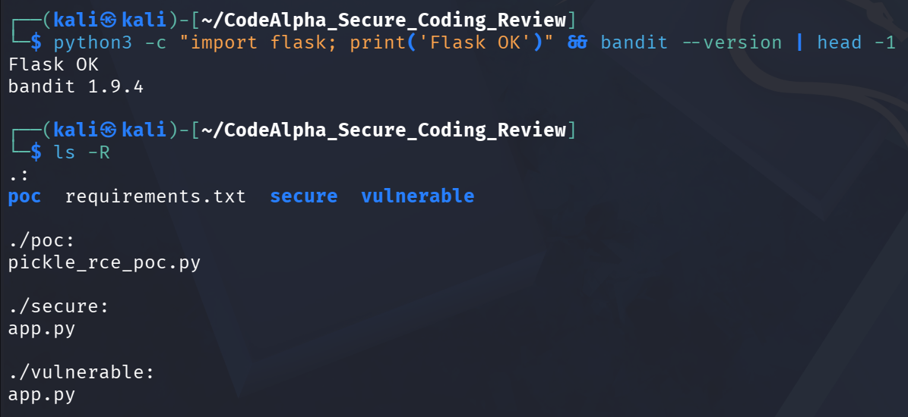
</p>
<p align="center"><sub><b>Figure 1:</b> Flask and Bandit installed on Kali, and the project layout.</sub></p>

---

## Repository Structure

```
CodeAlpha_Secure_Coding_Review/
├── vulnerable/
│   └── app.py              # original app with 12 vulnerabilities
├── secure/
│   └── app.py              # fixed app, each fix tagged [V-01] ... [V-12]
├── poc/
│   └── pickle_rce_poc.py   # proof of concept for V-07 (harmless, writes a text file)
├── screenshots/            # Figures 1–14
├── requirements.txt
└── README.md
```

To run either version:

```bash
sudo apt install python3-flask bandit -y
cd vulnerable && python3 app.py      # or: cd secure && python3 app.py
```

---

## Review Methodology

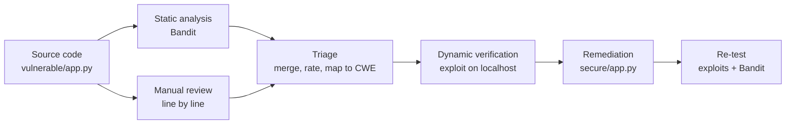

<div align="justify">

I used three methods because each one catches things the others miss. Bandit is fast and consistent but only recognises patterns it already knows. Manual review finds logic flaws such as missing access checks, which no pattern can describe. Exploiting each finding on a local copy then proves it is real, which removes false positives and gives a fair severity rating.

</div>

| Method | What It Is Good At | What It Misses |
|---|---|---|
| Static analysis (Bandit) | Dangerous functions: `pickle`, `os.popen`, MD5, string-built SQL, `debug=True` | Logic and access-control flaws, template issues, missing protections |
| Manual review | Authorization logic, data flow from user input to output, missing controls | Slow, and depends on the reviewer's experience |
| Dynamic verification | Proving impact, ruling out false positives | Only tests what you think to try |

---

## Static Analysis with Bandit

<div align="justify">

Running `bandit -r vulnerable/` scanned 156 lines of code and reported 10 issues: 4 High, 4 Medium and 2 Low. They map to 7 of the 12 final findings.

</div>

<p align="center">
  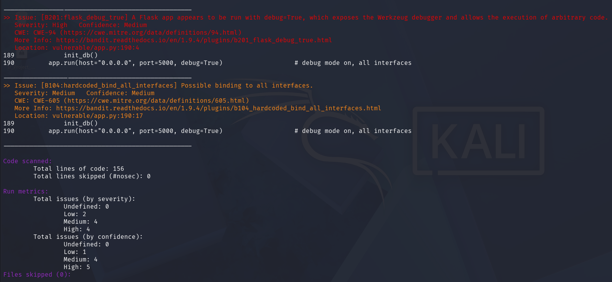
</p>
<p align="center"><sub><b>Figure 2:</b> Bandit results for the vulnerable app, ending with the debug-mode and bind-all-interfaces issues and the severity totals.</sub></p>

| Bandit Test | Line | Bandit Severity | Description | Finding |
|---|:---:|:---:|---|:---:|
| B608 hardcoded_sql_expressions | 89 | Medium | SQL query built with an f-string in login | V-01 |
| B608 hardcoded_sql_expressions | 160 | Medium | SQL query built with `%` formatting in search | V-02 |
| B105 hardcoded_password_string | 20 | Low | Secret key written in source code | V-04 |
| B324 hashlib | 53, 88 | High | MD5 used for password hashing | V-05 |
| B403 / B301 pickle | 13, 118 | Low / Medium | `pickle.loads()` on data from a cookie | V-07 |
| B605 start_process_with_a_shell | 181 | High | `os.popen()` with user input | V-11 |
| B201 flask_debug_true | 190 | High | Flask debug mode enabled | V-12 |
| B104 hardcoded_bind_all_interfaces | 190 | Medium | Server listens on `0.0.0.0` | V-12 |

> [!IMPORTANT]
> Bandit's severity is not the same as real risk. It rated the pickle issue **Medium** and the hardcoded secret key **Low**, but in this app the first leads to remote code execution and the second lets an attacker forge an admin session. Every tool result needs a human to judge its impact in context.

---

## Manual Code Review

<div align="justify">

Reading the code route by route, following each piece of user input to where it is used, turned up five problems Bandit has no rule for. The clearest example is `view_note()`. The function checks that you're logged in, but it never checks that the note you asked for is yours. It also renders the note body with Jinja's `|safe` filter, which switches off HTML escaping.

</div>

<p align="center">
  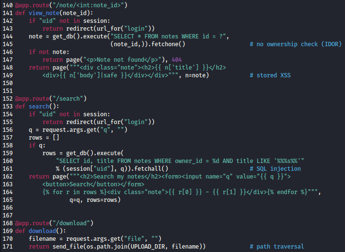
</p>
<p align="center"><sub><b>Figure 3:</b> Lines 140–171: the missing ownership check (line 145), the <code>|safe</code> filter (line 149), string-formatted SQL (lines 160–161) and an unchecked file path (line 171).</sub></p>

| Missed by Bandit | Why a Scanner Can't See It |
|---|---|
| V-03 Stored XSS | The flaw is inside a Jinja template string, which Bandit doesn't parse |
| V-06 Path traversal | `os.path.join()` and `send_file()` are normal functions; the problem is that the input is never checked |
| V-08 IDOR | The query is safe SQL. What's missing is an `AND owner_id = ?` condition, which is business logic |
| V-09 Missing CSRF | Bandit reports risky code, not missing protection |
| V-10 Cookie and header settings | Also a missing control rather than a dangerous call |

---

## Findings Summary

| ID | Vulnerability | CWE | OWASP Top 10 (2021) | Severity | Location | Found By |
|:---:|---|:---:|:---:|:---:|:---:|:---:|
| V-01 | SQL injection in login | CWE-89 | A03 Injection | **Critical** | L89–90 | Bandit + Manual |
| V-07 | Insecure deserialization (pickle cookie) | CWE-502 | A08 Integrity Failures | **Critical** | L118 | Bandit |
| V-11 | OS command injection in ping tool | CWE-78 | A03 Injection | **Critical** | L181 | Bandit + Manual |
| V-02 | SQL injection in search | CWE-89 | A03 Injection | High | L159–161 | Bandit + Manual |
| V-03 | Stored cross-site scripting | CWE-79 | A03 Injection | High | L149 | Manual |
| V-04 | Hardcoded secret key | CWE-798 | A07 Auth Failures | High | L20 | Bandit |
| V-05 | Weak password hashing (unsalted MD5) | CWE-916 | A02 Crypto Failures | High | L53, L88 | Bandit |
| V-06 | Path traversal in file download | CWE-22 | A01 Broken Access Control | High | L171 | Manual |
| V-08 | Insecure direct object reference | CWE-639 | A01 Broken Access Control | High | L144–145 | Manual |
| V-12 | Debug mode on, bound to all interfaces | CWE-489 | A05 Misconfiguration | High | L190 | Bandit |
| V-09 | No CSRF protection on forms | CWE-352 | A01 Broken Access Control | Medium | All POST forms | Manual |
| V-10 | Missing SameSite cookie flag and security headers | CWE-693 | A05 Misconfiguration | Low | App config | Manual |

<div align="right"><a href="#readme-top">↑ Back to top</a></div>

---

## Detailed Findings and Remediation

### V-01: SQL Injection in Login (Critical)

<div align="justify">

The login query is built by pasting the username straight into the SQL string. Entering `admin'--` closes the quoted string after `admin` and turns the rest of the query, including the password check, into a comment. The database returns the admin row and the app logs the attacker in.

</div>

```python
# Vulnerable (line 89)
query = (f"SELECT * FROM users WHERE username = '{username}' "
         f"AND password = '{password}'")
```

```python
# Fixed: parameterised query, password checked separately
user = db.execute("SELECT * FROM users WHERE username = ?", (username,)).fetchone()
if user and check_password_hash(user["password"], password):
```

<p align="center">
  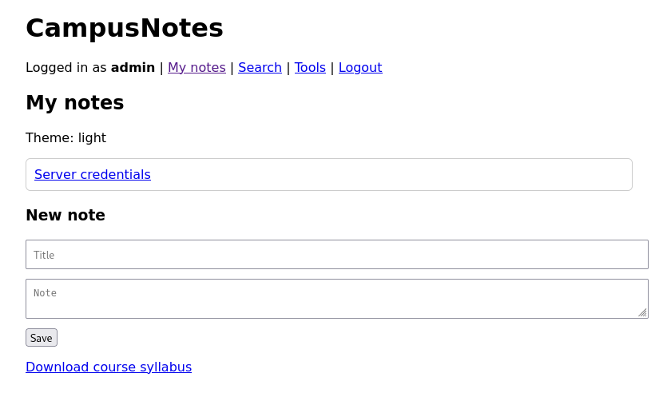
</p>
<p align="center"><sub><b>Figure 4:</b> Logged in as <b>admin</b> using the username <code>admin'--</code> and a wrong password.</sub></p>

### V-03: Stored Cross-Site Scripting (High)

<div align="justify">

Jinja escapes HTML by default, but the note body is rendered with `|safe`, which turns that protection off. A note containing `<script>alert('XSS')</script>` runs as JavaScript in the browser of anyone who opens it. A real attacker would use this to steal session cookies or act as the victim.

</div>

```python
# Vulnerable (line 149)
<div>{{ n['body']|safe }}</div>
```

```python
# Fixed: let Jinja escape the content; a CSP header is added as a second layer
<div style="white-space:pre-wrap">{{ n['body'] }}</div>
```

<p align="center">
  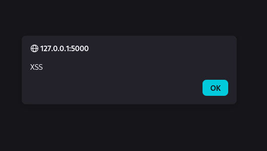
</p>
<p align="center"><sub><b>Figure 5:</b> The script stored in bob's note runs when the note is opened.</sub></p>

### V-08: Insecure Direct Object Reference (High)

<div align="justify">

Notes are fetched by ID alone. Logged in as **bob**, changing the URL to `/note/1` opened the admin's private note, which contained a database root password. Any user can read every note by counting upwards.

</div>

```python
# Vulnerable (lines 144-145)
note = db.execute("SELECT * FROM notes WHERE id = ?", (note_id,)).fetchone()
```

```python
# Fixed: the note must belong to the logged-in user
note = db.execute("SELECT * FROM notes WHERE id = ? AND owner_id = ?",
                  (note_id, session["uid"])).fetchone()
```

<p align="center">
  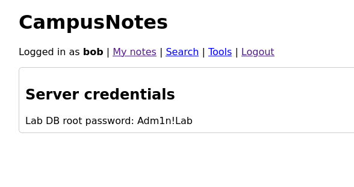
</p>
<p align="center"><sub><b>Figure 6:</b> Bob reading the admin's "Server credentials" note.</sub></p>

### V-11: OS Command Injection (Critical)

<div align="justify">

The ping tool joins user input onto a shell command and runs it with `os.popen()`. The shell treats `;` as "run the next command", so `127.0.0.1; id; whoami` ran two extra commands on the server. The output shows they ran as user `kali`, who is in the `sudo` group.

</div>

```python
# Vulnerable (line 181)
output = os.popen("ping -c 2 " + host).read()
```

```python
# Fixed: validate as an IP address, then run without a shell
host = str(ipaddress.ip_address(request.form.get("host", "").strip()))
result = subprocess.run(["ping", "-c", "2", host],
                        capture_output=True, text=True, timeout=10)
```

<p align="center">
  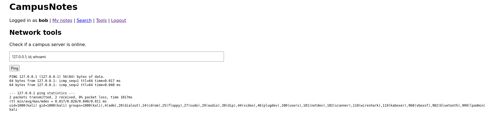
</p>
<p align="center"><sub><b>Figure 7:</b> The ping output followed by the results of <code>id</code> and <code>whoami</code>.</sub></p>

### V-06: Path Traversal (High)

<div align="justify">

The download route joins the `file` parameter onto the uploads folder without checking it. `../` sequences walk out of that folder, so a single request with no login read `/etc/passwd` from the server. The same trick could read the app's source code or its database.

</div>

```python
# Vulnerable (line 171)
return send_file(os.path.join(UPLOAD_DIR, filename))
```

```python
# Fixed: login required, and send_from_directory refuses paths outside UPLOAD_DIR
login_required()
return send_from_directory(UPLOAD_DIR, filename, as_attachment=True)
```

<p align="center">
  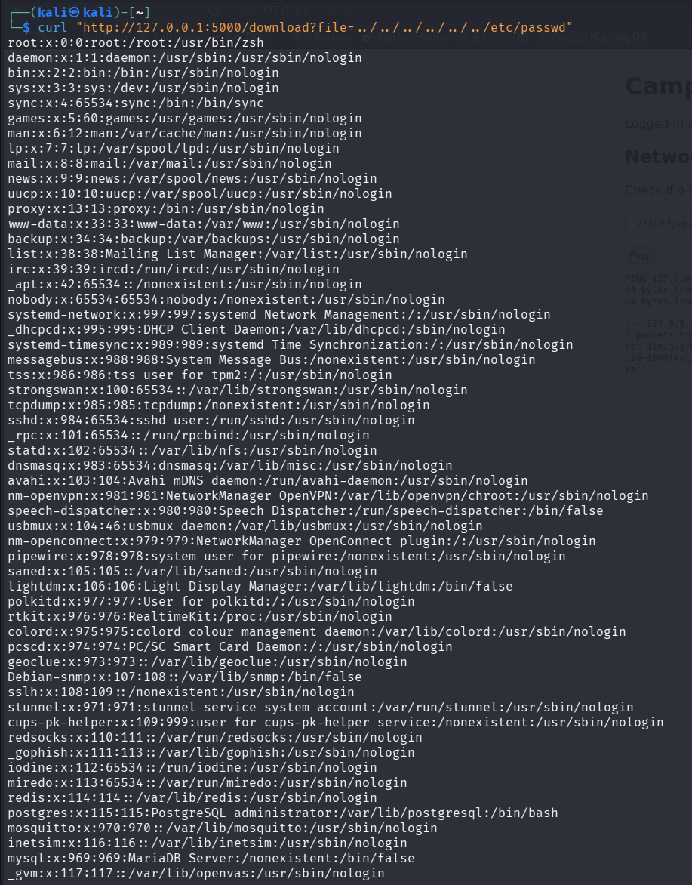
</p>
<p align="center"><sub><b>Figure 8:</b> <code>curl</code> retrieving <code>/etc/passwd</code> through the download link, without logging in.</sub></p>

### V-07: Insecure Deserialization (Critical)

<div align="justify">

The home page reads a `prefs` cookie and passes it to `pickle.loads()`. Pickle can rebuild any Python object, including one that runs a system command while it's being loaded, and the cookie is fully controlled by the user. Running `poc/pickle_rce_poc.py` sent a crafted cookie that made the server create `/tmp/campusnotes_pwned.txt`, which confirms remote code execution. The fix swaps pickle for JSON, which can only hold data, and accepts only known theme values.

</div>

```python
# Vulnerable (line 118)
prefs = pickle.loads(base64.b64decode(request.cookies["prefs"]))
```

```python
# Fixed
prefs = json.loads(request.cookies.get("prefs", "{}"))
if prefs.get("theme") in ("light", "dark"):
    theme = prefs["theme"]
```

### Other Findings

| ID | Problem | Impact | Remediation |
|:---:|---|---|---|
| V-02 | Search query built with `%` string formatting | `' UNION SELECT username, password FROM users--` dumps every user's password hash | Parameterised query: `title LIKE ?` with `f"%{q}%"` as the parameter |
| V-04 | `app.secret_key = "campusnotes-secret-123"` in source | Anyone with the code can sign a session cookie as admin | Load from an environment variable, falling back to `secrets.token_hex(32)` |
| V-05 | Passwords stored as unsalted MD5 | Leaked hashes crack in seconds with a wordlist or lookup table | `generate_password_hash()` / `check_password_hash()` from Werkzeug (salted scrypt) |
| V-09 | No CSRF tokens on any form | Another site can make a logged-in user submit forms | Random per-session token in every form, checked with `secrets.compare_digest()` on each POST |
| V-10 | No `SameSite` cookie setting and no security headers | Weaker defence against CSRF, XSS and clickjacking | `SameSite=Lax` and `HttpOnly` cookies, plus `Content-Security-Policy`, `X-Frame-Options`, `X-Content-Type-Options` and `Referrer-Policy` headers |
| V-12 | `debug=True` and `host="0.0.0.0"` | Errors show full stack traces and source, and the Werkzeug debugger is reachable from the network | `debug=False` and `host="127.0.0.1"`; use a production WSGI server behind a proxy for real deployment |

The login page was also changed to show one generic error ("Invalid username or password") instead of echoing the username back, and the session is cleared on login to prevent session fixation.

<div align="right"><a href="#readme-top">↑ Back to top</a></div>

---

## Remediation Verification

<div align="justify">

I ran the same attacks against `secure/app.py`, then scanned it again with Bandit.

</div>

| Attack | Vulnerable App | Secure App | Evidence |
|---|---|---|:---:|
| Login with `admin'--` | Logged in as admin | "Invalid username or password" | Fig. 9 |
| `<script>alert('XSS')</script>` in a note | Script runs | Shown as plain text | Fig. 10 |
| Bob opens `/note/1` | Admin's note shown | "Note not found" | Fig. 11 |
| `127.0.0.1; id; whoami` in Tools | Commands run | "Please enter a valid IPv4 or IPv6 address." | Fig. 12 |
| `curl ...?file=../../../../../../etc/passwd` | File contents returned | Redirected to login; returns 404 when logged in | Fig. 13 |
| Malicious pickle cookie | Command runs on server | Ignored (parsed as JSON) | PoC script |
| Bandit scan | 10 issues (4 High) | **No issues identified** | Fig. 14 |

<table>
<tr>
<td width="50%" valign="top">
<p align="center">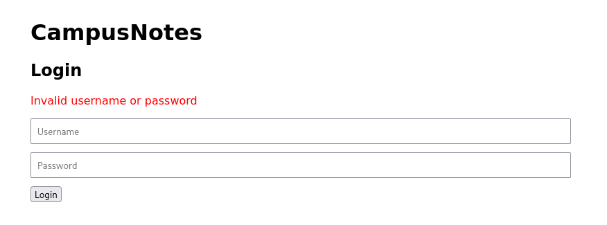</p>
<p align="center"><sub><b>Figure 9:</b> The SQL injection login now fails.</sub></p>
</td>
<td width="50%" valign="top">
<p align="center">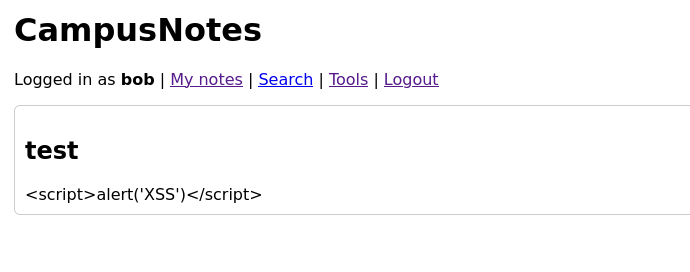</p>
<p align="center"><sub><b>Figure 10:</b> The XSS payload is displayed as text.</sub></p>
</td>
</tr>
<tr>
<td width="50%" valign="top">
<p align="center">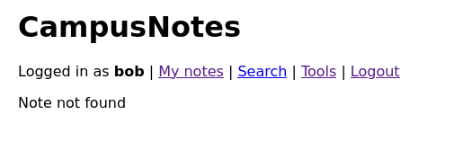</p>
<p align="center"><sub><b>Figure 11:</b> Bob can no longer open the admin's note.</sub></p>
</td>
<td width="50%" valign="top">
<p align="center">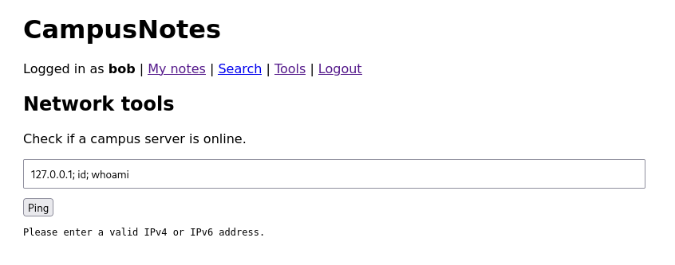</p>
<p align="center"><sub><b>Figure 12:</b> Input that isn't an IP address is rejected.</sub></p>
</td>
</tr>
</table>

<p align="center">
  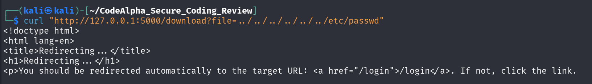
</p>
<p align="center"><sub><b>Figure 13:</b> The traversal request is redirected to the login page instead of returning the file.</sub></p>

<p align="center">
  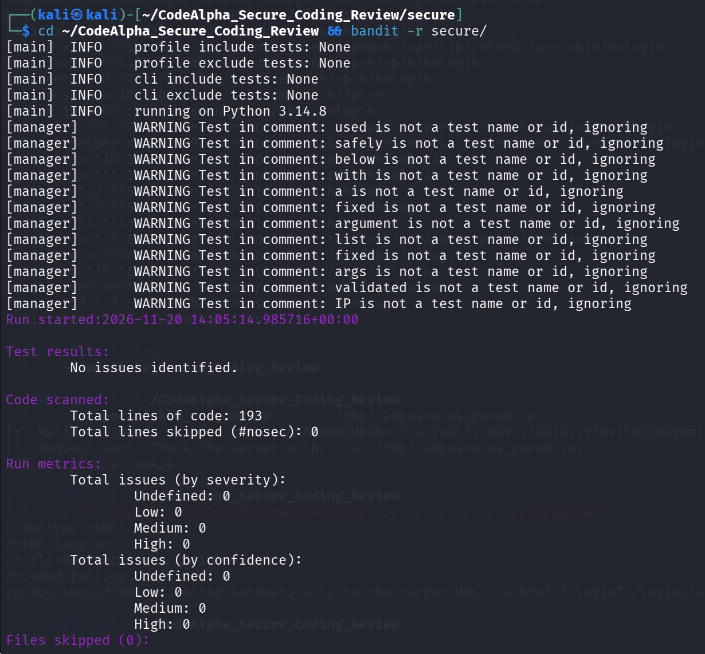
</p>
<p align="center"><sub><b>Figure 14:</b> Bandit reports no issues in the secure version.</sub></p>

> [!NOTE]
> The secure version suppresses three Bandit notices (B404, B603, B607) with `# nosec` comments on the ping call, each with a justification above it. The command uses a fixed argument list, no shell, and an input already validated as an IP address, so these are reviewed and accepted rather than hidden.

---

## Secure Coding Best Practices

| Area | Practice | Applied In |
|---|---|:---:|
| Database access | Always use parameterised queries or an ORM; never build SQL with f-strings, `%` or `+` | V-01, V-02 |
| Output encoding | Keep template auto-escaping on; avoid `\|safe`, `Markup()` and `innerHTML` with user data | V-03 |
| Access control | Check ownership on every request for a specific object, not just that the user is logged in | V-08 |
| OS commands | Avoid the shell entirely; pass a list to `subprocess.run()` and validate input against an allow-list | V-11 |
| File handling | Use `send_from_directory()` or resolve the path and confirm it stays inside the allowed folder | V-06 |
| Untrusted data | Never unpickle data from users; use JSON and validate the values | V-07 |
| Passwords | Use a slow, salted algorithm (scrypt, bcrypt or Argon2) through a trusted library | V-05 |
| Secrets | Keep keys and passwords out of source code; load them from environment variables or a secrets manager | V-04 |
| Forms | Protect every state-changing request with a CSRF token | V-09 |
| Configuration | Debug off in production, bind to localhost behind a reverse proxy, set secure cookie flags and security headers | V-10, V-12 |
| Process | Run a static analyzer in CI, but always pair it with manual review, since Bandit missed 5 of 12 findings here | All |

---

## Conclusion

<div align="justify">

The review found 12 vulnerabilities in under 200 lines of Python, and three of them would let an outsider run commands on the server. None of them needed anything clever to exploit. A quote mark, a semicolon and a few `../` were enough.

The most useful lesson was how Bandit and manual review complement each other. Bandit found the dangerous function calls in seconds, but it rated a remote code execution bug as Medium and missed every access-control flaw. Those only appeared when I followed the user's input through each route and asked who should be allowed to see the result. Confirming each finding with a working exploit, then repeating the same attacks against the fixed version, turned the review from a list of possible issues into evidence that the code is now safe against them.

</div>

---

<div align="center">

**Ali Abbas Qazi**

[](https://www.linkedin.com/in/ali-abbas-qazi/)
[](https://github.com/Ali-Abbas-Qazi)
[](https://ali-abbas-qazi.github.io)

<a href="#readme-top">↑ Back to top</a>

</div>
